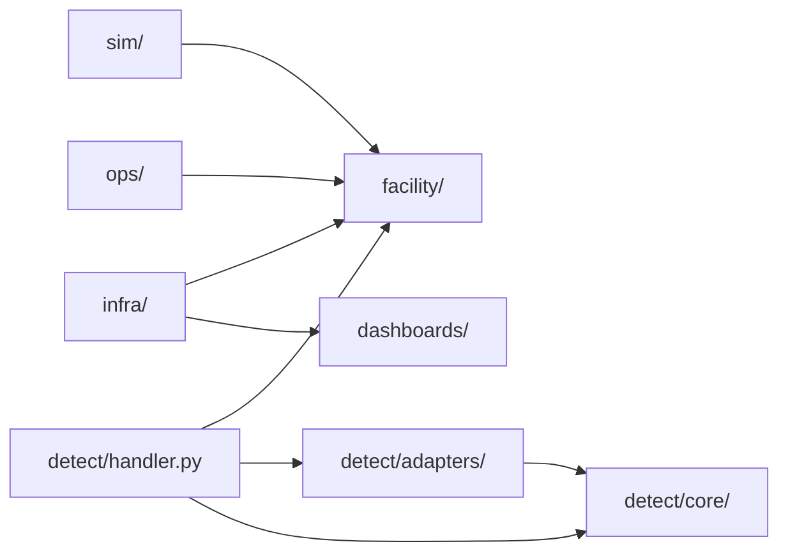
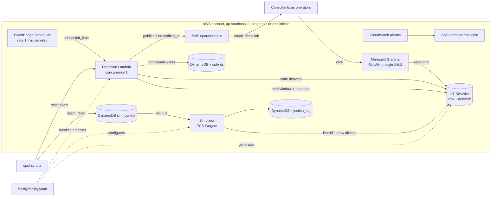
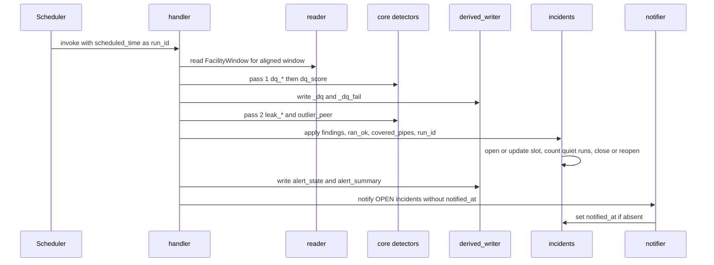

# Architecture Spine — Pipe Integrity Streaming POC

## Design Paradigm

**Pipes and filters**, one store per hand-off:

simulator → IoT SiteWise (raw) → detection run → SiteWise (derived) + `incidents` table → notifier (SNS email)

Grafana reads SiteWise only. Inside detection: **hexagonal**, pure detectors in `detect/core/`, all I/O in `detect/adapters/`.



Arrows point from importer to imported. `detect/core/` imports only its own `models.py`. `sim/`, `detect/` and `ops/` never import each other. `tests/test_layers.py` enforces these rules.

## Deviations from spec

- **SiteWise native anomaly detection is excluded** from the POC by user decision. Detection is deterministic Python detectors (AD-5). The SPEC constraint has been updated to match. No synthetic backfill for model training (AD-9).

## Invariants & Rules

### AD-1 — SiteWise property aliases are the ingestion contract [ADOPTED]

- **Binds:** CAP-1, `sim/`, future real stream, future historian connectors
- **Prevents:** a simulator-only ingestion path that must be rebuilt for the client's stream
- **Rule:**
  - Raw values enter only through `BatchPutAssetPropertyValue` addressed by `propertyAlias`.
  - Later producers (real stream, historian such as PI, other connectors) are allowed only if they write through the same SiteWise aliases. The platform coexists with the historian and never replaces it as system of record.
  - [ASSUMPTION] The client's real stream reaches AWS through a SiteWise Edge gateway or another path that can write SiteWise aliases. If it arrives via IoT Core or Kinesis, an IoT rule action to SiteWise keeps AD-1 intact.
  - No component derives pipe or measurement by parsing an alias string. Mapping comes from `facility/model.py` or SiteWise asset metadata.
  - Disassociated data streams are never enabled. The simulator calls `DescribeTimeSeries` for every alias at startup and refuses to start if any is unassociated.

### AD-2 — `facility/facility.yaml` is the single authored facility model

- **Binds:** CAP-2, CAP-5, `sim/`, `infra/`, `detect/`, `ops/`
- **Prevents:** simulator, SiteWise and detectors holding different pipe, sensor or tunable lists
- **Rule:**
  - Pipes, sensors, pipe attributes, data contracts and tunables are authored only in `facility.yaml` and parsed only by `facility/model.py` (AD-14).
  - SiteWise asset models and assets, simulator config and dashboard variables are generated from it.
  - At runtime, detection reads **asset metadata** (attributes, contracts, aliases) from SiteWise. **Tunables** come from the `facility.yaml` bundled into the Lambda asset, loaded via `facility/model.py`. No other copy exists.

### AD-3 — Raw data is written once, only by the producer

- **Binds:** CAP-1, CAP-3, CAP-6, MRV lineage
- **Prevents:** derived values overwriting or mixing with raw measurements
- **Rule:**
  - Only the producer writes raw aliases. Nothing updates or deletes them. Values are stored as produced, never clamped.
  - The simulator never resends a timestamp: per-alias timestamps strictly increase, and after a restart it resumes at wall-clock now.
  - Derived values live only under the `derived/` alias segment, written only by the detection run (AD-13). IAM enforces both (AD-17).

### AD-4 — Detectors never see ground truth

- **Binds:** CAP-3, CAP-4, `sim/`, `detect/`, `ops/`
- **Prevents:** detection that reads which faults or leaks were injected
- **Rule:**
  - Injections exist only in `sim_control` and the `injection_log` table. The detection role has no IAM access to either (AD-17).
  - Detectors may know injection *types* (the catalogue in Consistency Conventions), never instances.

### AD-5 — Detectors are pure functions over fixed types

- **Binds:** CAP-3, CAP-4, CAP-5, CAP-6, `detect/core/`
- **Prevents:** detectors with their own I/O, incompatible inputs or result shapes
- **Rule:**
  - Every detector imports types only from `detect/core/models.py` (Shared Shapes) and declares `id`, `version`, `kind` (`pipe` or `facility`).
  - `pipe` detectors are called once per pipe with a `PipeWindow`; `facility` detectors once per run with a `FacilityWindow`. Both return `list[Finding]`.
  - Detectors do no I/O, never read the environment, never compute `_dq`.
  - Two passes per run: pass 1 runs `dq_*` detectors, then `dq_score.py` fills `PipeMeta.dq`; pass 2 runs `leak_*` and `outlier_*`, which exclude any sensor with `dq < tunables.dq_min` and say so in the explanation.
  - An exception in one detector is logged, the detector is left out of `ran_ok`, and the others continue.

### AD-6 — One OPEN incident per pipe, in the `incidents` table

- **Binds:** CAP-6, CAP-7
- **Prevents:** duplicate alerts for one event, more than one writer of alert state, flapping re-alerts
- **Rule:**
  - Only `detect/adapters/incidents.py` writes the `incidents` table (Incident item v1).
  - A pipe has at most one OPEN incident, enforced by DynamoDB: the slot `pk=<pipe_id>, sk=OPEN` is created with `attribute_not_exists(pk)`; `ConditionalCheckFailed` means update.
  - Every finding on a pipe, of any family, joins that pipe's incident: it upserts `detectors[<detector_id>]` (latest confidence and explanation, `quiet_runs=0`), unions `evidence_aliases`, widens `evidence_to`. `evidence_from` never moves after open. Incident `confidence` = max over detectors.
  - Quiet counting: a detector's `quiet_runs` increments only in runs where it is in `ran_ok`, the pipe is in `covered_pipes`, and it produced no finding. Otherwise it is unchanged.
  - Close when every detector has `quiet_runs >= tunables.quiet_runs_to_close`: one `TransactWriteItems` deletes the slot and puts `sk=C#<incident_id>`, `status=CLOSED`.
  - Reopen: a finding within `tunables.reopen_grace_s` of the pipe's latest close restores that incident (same `incident_id`, `notified_at` kept, no new email). Incidents closed by reset never reopen.
  - Every write carries `last_run` and is conditional on `last_run < :run_id` (AD-12).

### AD-7 — Email via a `notified_at` outbox, one email per incident

- **Binds:** CAP-7, demo-only constraint
- **Prevents:** lost emails after partial failure, duplicate senders, emails to client operators
- **Rule:**
  - `detect/adapters/notifier.py` runs in-process at the end of each run, after incident writes. No DynamoDB Stream exists on `incidents`.
  - For every OPEN incident without `notified_at`: publish to the stage's operator topic, then `SET notified_at` with `attribute_not_exists(notified_at)`. A failed publish is logged and retried by the next run.
  - Detectors joining an already-notified incident send no new email.
  - Subscriptions come only from the CDK context allowlist `operator_emails` (consultants). The topic policy denies `Subscribe` to every principal except the deploy role.
  - Message format is fixed (Shared Shapes, Email v1).

### AD-8 — Every incident opens its evidence in one click, via one link template

- **Binds:** CAP-6, CAP-7, `dashboards/`, notifier
- **Prevents:** links that don't resolve, lose the contributing sensors, or drift from the dashboard
- **Rule:**
  - The link is built only by `detect/adapters/deeplink.py::build_link(incident, grafana_url, dashboard_uid)` using the literal Deep link v1 template (Shared Shapes).
  - `dashboards/pipe-detail.json` declares uid `pipe-detail`, textbox variables `pipe_id` (value `P-xxx`, not an asset ID) and `area`, a constant `alias_root`, and a multi-value `evidence` variable that highlights panels. Panels query raw values by alias, not aggregates.
  - `tests/test_deeplink_contract.py` loads the dashboard JSON and asserts the uid and variable names.

### AD-9 — Time is UTC; the simulator runs in real time; windows are aligned

- **Binds:** all
- **Prevents:** unaligned windows, tail gaps from ingest lag, a demo that isn't live
- **Rule:**
  - SiteWise timestamps: UTC epoch seconds plus nanos. Stored strings: `YYYY-MM-DDTHH:MM:SS.sssZ`. `detect/core/` uses tz-aware UTC `datetime`; conversion happens only in adapters.
  - The simulator emits at wall-clock time. No backfill, no time acceleration.
  - `window_end = floor_minute(scheduled_time) − tunables.ingest_lag_s`; `window_start = window_end − tunables.window_len_s`. All derived writes are timestamped `window_end`, so a replayed run overwrites identically.
  - Injections are triggered only through `sim_control` (AD-15).

### AD-10 — One account, one region, one CDK app

- **Binds:** `infra/`, deployment
- **Prevents:** console-built resources, broken deploy ordering
- **Rule:**
  - All AWS resources come from one CDK (Python) app in one account, region `ap-southeast-1` (Singapore) [ADOPTED], deployed per stage (AD-16).
  - The simulator stack depends on the SiteWise asset stack. The simulator image and asset models build from the same commit.

### AD-11 — Read-only toward OT and client source systems

- **Binds:** all
- **Prevents:** any path that writes back to OT
- **Rule:**
  - No component writes to OT or client source systems. Platform stores are written only as AD-3, AD-6, AD-13 and AD-17 allow.
  - Grafana holds only `AWSIoTSiteWiseReadOnlyAccess`.

### AD-12 — Single-flight detection

- **Binds:** `detect/`, `infra/`
- **Prevents:** overlapping runs creating duplicate incidents, emails or out-of-order derived writes
- **Rule:**
  - Detection Lambda: reserved concurrency 1, timeout 50 s, async `MaximumRetryAttempts=0`, `MaximumEventAgeInSeconds=60`.
  - EventBridge Scheduler: `rate(1 minute)`, flexible time window `OFF`, retry attempts 0, input `{"scheduled_time": "<aws.scheduler.scheduled-time>"}`.
  - `run_id` = `scheduled_time`, never `now()`. A run with a `run_id` at or before the stored `last_run` makes no incident writes.
  - The next scheduled run is the only retry.

### AD-13 — Derived properties v1 and `dq_score` ownership

- **Binds:** CAP-3, CAP-6, `detect/`, `dashboards/`, `infra/`
- **Prevents:** type mismatches between writer and dashboard, inverted or ad-hoc scores, alert detail invisible to Grafana
- **Rule:**
  - Derived properties are exactly the Derived properties v1 table, declared in the asset model generated from `facility.yaml`.
  - All are written every run for every pipe and sensor, at `window_end`, by `detect/adapters/derived_writer.py` only.
  - `detect/core/dq_score.py::score(findings_for_alias) -> (dq, failing)` is the sole owner: `dq = 1 − max(confidence of dq_* findings naming the alias)`, `1.0` if none; `failing` = sorted `dq_*` IDs. An alias with no samples in the window scores `0.0` with `dq_gap`.
  - `alert_state` and `alert_summary` are written after incident updates in the same run.

### AD-14 — `facility.yaml` schema v1 and its single loader

- **Binds:** CAP-2, CAP-5, `facility/`, `sim/`, `infra/`, `detect/handler.py`, `ops/`
- **Prevents:** consumers parsing different mental schemas; authored aliases drifting from mapped ones
- **Rule:**
  - `facility/model.py::load(path) -> Facility` is the only parser. It validates schema v1 (Shared Shapes) and fails on any violation.
  - Aliases are derived by `Facility.alias(pipe_id, measurement)` and `Facility.derived_alias(pipe_id, name)`, never authored.
  - Validation: unique `P-\d{3}` IDs; `area` in `areas`; every sensor has a complete contract (CAP-2: 100% mapped); units match the fixed unit table; every `peer_group` has at least 4 pipes.
  - `Facility.config_hash()` = sha256 of canonical `tunables`, recorded on every incident and run log line.
  - SiteWise mapping: one `Facility` root asset; one `Pipe` asset model with the 6 measurements, the derived properties, and attributes `pipe_id`, `area`, `service`, `material`, `age_years`, `peer_group`, `<m>_unit`, `<m>_min`, `<m>_max`, `<m>_rate_hz`, `<m>_owner`.
  - `outlier_peer` groups only by `peer_group`.

### AD-15 — Demo operations: warm-up, injection, reset, fallback

- **Binds:** success signal, CAP-1 to CAP-7, `sim/`, `ops/`
- **Prevents:** incompatible demo assumptions, lost injections, unrecoverable rehearsals
- **Rule:**
  - Warm-up: the `poc` simulator runs at least 30 min (≥ 2 × `window_len_s`) before the demo. Detectors need no more history than that.
  - Latency target: injection to email ≤ 5 min. Leak magnitudes in the catalogue are sized so `leak_mass_balance` fires within 2 runs.
  - Injection: only `ops/inject.py` writes `sim_control` (sim_control item v1). Items are immutable; cancel = new item with `supersedes`. The simulator polls every ≤ 5 s, read-only, and appends to `injection_log` on first apply.
  - Reset (`ops/reset.py`): invoke detection with `{"action": "reset"}` so `incidents.py` closes all OPEN incidents (`closed_reason=reset`), then delete all `sim_control` items. Raw data and `injection_log` are untouched; the demo uses the time range after reset.
  - Smoke (`ops/smoke.py`): inject a leak on a test pipe, wait for an OPEN incident with `notified_at`, assert the link resolves to `pipe-detail`.
  - Pre-demo checklist: every SNS subscription confirmed, warm-up elapsed, smoke passed, reset run.
  - Health: CloudWatch alarms (detection Lambda errors ≥ 1 in 5 min, simulator running tasks < 1) go to the separate `team-alarms-<stage>` topic, never the operator topic.
  - Fallback: a screen recording of a full rehearsal run.

### AD-16 — Environments: shared `poc` stage plus per-developer stages

- **Binds:** `infra/`, `dashboards/`, all developers
- **Prevents:** concurrent deploys overwriting each other, alias collisions between stages, hand-built Grafana state
- **Rule:**
  - `cdk deploy -c stage=<stage>`. Stages: `poc` (integration and demo) and `poc-<initials>` (one per developer). Every resource name is suffixed with the stage.
  - `alias_root` is `/lng1` for `poc` and `/<stage>/lng1` otherwise. `facility/model.py` applies it.
  - One Grafana workspace, owned by the `poc` stage. Each stage provisions its own folder, data source and dashboards with uid `pipe-detail` (poc) or `pipe-detail-<initials>`. `DASHBOARD_UID`, `GRAFANA_URL` and `STAGE` reach the Lambda as CDK-set env vars.
  - `infra/grafana_provision.py` installs the SiteWise plugin 2.6.3 and creates data source and dashboards through the Grafana HTTP API with a short-lived service-account token, after `cdk deploy`.
  - Deploys run only in GitHub Actions (`.github/workflows/deploy.yml`, runbook `docs/ci-cd.md`) through OIDC. GitHub holds no AWS keys.
  - Trust is scoped by GitHub environment, with exact `sub` matches. `ongiiot-github-deploy` is trusted only for `repo:schuaschua@83538399/ongiiot@1392670803:environment:poc` and `…:environment:dev`, and can only assume the CDK bootstrap roles. `ongiiot-github-diff` is trusted only for `repo:schuaschua@83538399/ongiiot@1392670803:pull_request`, and can only assume the read-only CDK lookup role.
  - Every deploy runs the test suite first; the `deploy` job needs it to pass before AWS is touched.
  - Nothing deploys automatically. `poc` deploys only by manual dispatch from `main` in the GitHub environment `poc` (branch rule `main`); starting the run is the approval, because GitHub Team has no required reviewers for private repos. `poc-<initials>` stages deploy by manual dispatch from any branch in the environment `dev`. Each run deploys only `*-<stage>`, one run per stage at a time.
  - Pull requests run tests, `cdk synth` and a read-only `cdk diff --method template` against `poc` with the diff role, and never deploy.
  - `GitHubOidcStack` is outside every stage. It is deployed once, locally, with `-c oidc=true`.
  - Residual risk: all stages share one account and one set of bootstrap roles, so a run holding `dev` credentials can technically reach `poc`. The `main`-only rule for `poc` is enforced against PRs and branch runs without an environment, not against an edited workflow on the `dev` path. There is no second-person approval.

### AD-17 — IAM write boundaries

- **Binds:** AD-3, AD-4, AD-11, `infra/`
- **Prevents:** honour-system ownership of raw, derived, alert and ground-truth data
- **Rule:** one role per component, exactly these grants:

| Role | Allowed | Denied explicitly |
| --- | --- | --- |
| Simulator task | `BatchPutAssetPropertyValue` on raw aliases; `DescribeTimeSeries`; `sim_control` read; `injection_log` write | `derived/*` aliases |
| Detection Lambda | SiteWise read (`ExecuteQuery`, `BatchGet*`, `Describe*`, `List*`); `BatchPutAssetPropertyValue` on `derived/*` only; `incidents` read/write; publish to operator topic | raw aliases, `sim_control`, `injection_log` |
| Ops (developer) | `sim_control` read/write/delete; invoke detection Lambda; `injection_log` read | SiteWise writes |
| Grafana | `AWSIoTSiteWiseReadOnlyAccess` | everything else |

  - [ASSUMPTION] SiteWise IAM can scope `BatchPutAssetPropertyValue` per alias prefix. Regardless, the raw writer in `sim/` rejects `derived/` aliases and `derived_writer.py` rejects all others, each with a unit test.

### AD-18 — SiteWise reads go through one reader adapter

- **Binds:** `detect/adapters/reader.py`, AD-5 types
- **Prevents:** the read path leaking into detectors or changing the `Window` type
- **Rule:**
  - `reader.py` returns `FacilityWindow` with raw samples and every expected alias present (empty list if no data).
  - Primary: `ExecuteQuery` filtered on `event_timestamp`. Fallback: `BatchGetAssetPropertyValueHistory` (16 entries per request, parallel). A day-1 spike at full load (50 pipes × 6 × 900 s) picks one; the choice stays inside the adapter.
  - Asset metadata is cached per cold start.

## Shared Shapes

### `detect/core/models.py` v1

```python
Quality = Literal["GOOD", "BAD", "UNCERTAIN"]
Sample(ts: datetime, value: float | None, quality: Quality)   # ts tz-aware UTC; gaps = absent samples, no fill
Contract(unit: str, min: float, max: float, rate_hz: float, owner: str)
PipeMeta(pipe_id: str, area: str, service: str, material: str, age_years: int, peer_group: str,
         aliases: dict[str, str],          # measurement -> raw alias
         contracts: dict[str, Contract],   # measurement -> contract
         dq: dict[str, float])             # measurement -> dq; filled after pass 1
Window(start: datetime, end: datetime, series: dict[str, list[Sample]])   # alias -> samples, ascending
PipeWindow(pipe: PipeMeta, window: Window)                                # only that pipe's aliases
FacilityWindow(pipes: dict[str, PipeMeta], window: Window)
Finding(detector_id: str, detector_version: str, pipe_id: str, evidence_aliases: tuple[str, ...],
        window_start: datetime, window_end: datetime, confidence: float,  # 0..1
        explanation: str)                                                 # one plain sentence
Tunables = Mapping[str, Any]                                              # facility.yaml `tunables`
# pipe detector:     detect(pw: PipeWindow, t: Tunables) -> list[Finding]
# facility detector: detect(fw: FacilityWindow, t: Tunables) -> list[Finding]
```

`dq_*` findings name exactly one alias in `evidence_aliases`.

### Derived properties v1

Alias: `<alias_root>/<area>/<pipe_id>/derived/<name>`. Timestamp: `window_end`. Written every run.

| Name | Level | SiteWise type | Value |
| --- | --- | --- | --- |
| `alert_state` | pipe | INTEGER | number of detectors in the OPEN incident; `0` if none |
| `alert_summary` | pipe | STRING ≤ 1024 B | JSON `{"incident_id","confidence","detectors":[{"id","c"}],"evidence":[alias]}` or `{}`; `evidence` dropped first if too long |
| `<measurement>_dq` | sensor | DOUBLE | `[0,1]`, 1 = fully trustworthy (AD-13) |
| `<measurement>_dq_fail` | sensor | STRING | comma-separated failing `dq_*` IDs, or empty |

### Incident item v1 (`incidents` table)

| Field | Type | Rule |
| --- | --- | --- |
| `pk` | S | `<pipe_id>` |
| `sk` | S | `OPEN` (live slot) or `C#<incident_id>` (closed history) |
| `incident_id` | S | ULID minted at open |
| `pipe_id`, `area` | S | per conventions |
| `status` | S | `OPEN` \| `CLOSED` |
| `opened_at`, `last_seen`, `closed_at` | S | `YYYY-MM-DDTHH:MM:SS.sssZ` |
| `closed_reason` | S | `quiet` \| `reset` |
| `evidence_from`, `evidence_to` | S | first `window_start` (fixed); max `window_end` |
| `evidence_aliases` | L of S | sorted union over lifetime |
| `detectors` | M | `detector_id → {confidence N, explanation S, version S, first_seen S, last_seen S, quiet_runs N}` |
| `confidence` | N | max of `detectors[*].confidence`, unrounded |
| `notified_at` | S or absent | outbox marker (AD-7) |
| `last_run` | S | `run_id` of last writing run |
| `config_hash` | S | `Facility.config_hash()` at last write |

### `facility.yaml` schema v1 (skeleton)

```yaml
version: 1
facility: {id: lng1, name: LNG Train 1}
areas: [train1, train2]
contracts:                       # default contract per measurement; unit fixed (Conventions)
  pressure_in:  {unit: Pa, min: 0, max: 10000000, rate_hz: 1, owner: Process Engineering}
  flow_in:      {unit: kg/s, min: 0, max: 50, rate_hz: 1, owner: Process Engineering}
  methane_ppm:  {unit: ppmv, min: 0, max: 10000, rate_hz: 1, owner: HSE}
  # pressure_out, flow_out, temperature follow the same shape
pipes:
  - id: P-007
    area: train1
    service: fuel_gas
    material: carbon_steel
    age_years: 12
    peer_group: fg-cs-10to15
    sensors: [pressure_in, pressure_out, flow_in, flow_out, temperature, methane_ppm]
    contract_overrides: {flow_in: {max: 80}}
tunables:
  window_len_s: 900
  ingest_lag_s: 60
  quiet_runs_to_close: 5
  reopen_grace_s: 600
  dq_min: 0.5
  detectors:                     # keys under each id are owned by that detector
    {leak_mass_balance: {}, leak_methane_rise: {}, outlier_peer: {}, dq_flatline: {}, dq_stuck: {}, dq_drift: {}, dq_gap: {}}
```

### sim_control item v1 (`sim_control` table)

| Field | Type | Rule |
| --- | --- | --- |
| `pk` | S | `injection_id` (ULID) |
| `type` | S | `leak` \| `dq_flatline` \| `dq_stuck` \| `dq_drift` \| `dq_gap` |
| `pipe_id` | S | target pipe |
| `measurement` | S or absent | required for `dq_*` types |
| `params` | M | per type, see injection catalogue |
| `start_at`, `end_at` | S | UTC ISO; applied while `start_at ≤ now < end_at` |
| `supersedes` | S or absent | `injection_id` this item cancels (its `end_at` wins) |

Shape lives in `facility/control.py`, shared by `ops/` and `sim/`.

### Deep link v1

```text
{GRAFANA_URL}/d/{DASHBOARD_UID}/pipe-detail?orgId=1
  &var-pipe_id={pipe_id}
  &var-area={area}
  &var-evidence={urlencode(alias_1)}&var-evidence={urlencode(alias_2)}...
  &from={epoch_ms(evidence_from) - 300000}
  &to={epoch_ms(evidence_to) + 300000}
```

Emitted on one line, no whitespace.

### Email v1

Subject `[POC] Pipe <pipe_id> incident <incident_id>`. Body lines in order: `POC - simulated data - evidence only, not an operational alert or official record`; pipe ID and area; incident confidence (2 dp); one line per detector (`detector_id`, confidence 2 dp, explanation); contributing aliases; Deep link v1.

## Consistency Conventions

| Concern | Convention |
| --- | --- |
| Pipe IDs | `P-001` … `P-050` |
| Raw aliases | `<alias_root>/<area>/<pipe_id>/<measurement>`, e.g. `/lng1/train1/P-007/flow_in`; `<area>` from `facility.yaml` `areas` |
| Measurements (`[ASSUMPTION]` 1 Hz) and fixed units | `pressure_in`, `pressure_out` Pa absolute; `flow_in`, `flow_out` kg/s mass flow; `temperature` K; `methane_ppm` ppmv (non-SI exception). Converted only at the dashboard |
| Detector IDs | family-prefixed snake_case: `dq_flatline`, `dq_stuck`, `dq_drift`, `dq_gap`, `leak_mass_balance`, `leak_methane_rise`, `outlier_peer` |
| Injection catalogue | `leak` (param `rate_kg_s`) → `flow_out` drops, `pressure_out` drops, `methane_ppm` rises (caught by `leak_mass_balance`, `leak_methane_rise`); `dq_flatline` → constant value; `dq_stuck` → last value repeated with GOOD quality; `dq_drift` (param `per_min`) → linear offset; `dq_gap` → no samples |
| IDs | `incident_id`, `injection_id`: ULID |
| Confidence | float 0–1, stored unrounded, shown to 2 dp |
| Logging | JSON lines to CloudWatch with `stage`, `run_id`, `config_hash`, and `pipe_id`, `detector_id`, `incident_id` when known; one summary line per run listing detector versions and `ran_ok` |
| Config | Resource names, `GRAFANA_URL`, `DASHBOARD_UID`, `STAGE` via CDK env vars. Tunables only in `facility.yaml` (AD-2). Operator emails in CDK context `operator_emails` |
| Errors | Detector failure: logged, skipped, excluded from `ran_ok`. Adapter failure: the invocation fails; the next scheduled run retries (AD-12) |
| Python deps | `uv` project; `uv.lock` pins all; Lambda bundle and simulator image install from it |

## Stack

| Name | Version |
| --- | --- |
| Python (Lambda runtime and simulator image `python:3.14-slim`) | 3.14 |
| aws-cdk-lib (CDK Python) | 2.271.0 |
| boto3 | pinned in `uv.lock`, bundled in the Lambda asset |
| PyYAML, python-ulid | pinned in `uv.lock` |
| AWS IoT SiteWise (assets, BatchPutAssetPropertyValue, ExecuteQuery, BatchGetAssetPropertyValueHistory) | managed service |
| Amazon Managed Grafana | Grafana 12.4 |
| IoT SiteWise Grafana data source plugin | 2.6.3 |
| AWS Lambda + EventBridge Scheduler (1-minute rate) | managed service |
| Amazon DynamoDB (`incidents`, `sim_control`, `injection_log`) | managed service |
| Amazon SNS (operator topic, team-alarms topic) | managed service |
| Amazon ECS on Fargate (simulator) `[ASSUMPTION]` | managed service |
| AWS IAM Identity Center (Grafana login) `[ASSUMPTION]` | managed service |
| GitHub Actions with AWS OIDC (`GitHubOidcStack`, roles `ongiiot-github-deploy` and `ongiiot-github-diff`) | managed service |
| AWS CDK CLI (CI, `npx aws-cdk@…`) | 2.1143.0 |
| Node.js (CI, for the CDK CLI) | 22 |

## Structural Seed

### Deploy topology (per stage)



### Incident flow (one run)



```text
facility/facility.yaml     # facility model and tunables (AD-2, AD-14)
facility/model.py          # the only loader; aliases, config_hash (AD-14)
facility/control.py        # sim_control item v1 (AD-15)
sim/                       # simulator, injection apply, injection_log writer (AD-1, AD-3, AD-4)
detect/core/models.py      # shared detector types (AD-5)
detect/core/dq_score.py    # sole dq owner (AD-13)
detect/core/detectors/     # one module per detector id (AD-5)
detect/adapters/           # reader, derived_writer, incidents, notifier, deeplink (AD-6, AD-7, AD-8, AD-13, AD-18)
detect/handler.py          # Lambda entry point, two-pass run (AD-5, AD-12)
ops/                       # inject.py, reset.py, smoke.py (AD-15)
infra/                     # CDK app per stage, grafana_provision.py (AD-10, AD-16, AD-17)
dashboards/                # facility-overview.json, pipe-detail.json (AD-8)
tests/                     # detector units, test_layers, test_deeplink_contract, alias-guard tests
.github/workflows/         # ci.yml (PR gate), deploy.yml (poc on main, dev stages by dispatch) (AD-16)
docs/ci-cd.md              # OIDC and GitHub environment runbook (AD-16)
```

## Capability → Architecture Map

| Capability | Lives in | Governed by |
| --- | --- | --- |
| CAP-1 live per-pipe view | `sim/`, SiteWise, `dashboards/` | AD-1, AD-9, AD-15 |
| CAP-2 sensor-to-pipe model and data contracts | `facility/`, `infra/`, SiteWise assets | AD-2, AD-14 |
| CAP-3 data-quality score naming failing checks | `detect/core/` `dq_*`, `dq_score.py`, derived properties | AD-3, AD-4, AD-5, AD-13 |
| CAP-4 leak/methane-loss detection | `leak_mass_balance`, `leak_methane_rise`, `sim/` injection | AD-4, AD-5, AD-15 |
| CAP-5 outliers among similar pipes | `outlier_peer` by `peer_group` | AD-5, AD-14 |
| CAP-6 explainable, grouped, traceable alerts | `incidents.py`, `alert_summary`, `dashboards/` | AD-6, AD-8, AD-12, AD-13 |
| CAP-7 email to the operator role | `notifier.py`, SNS | AD-7, AD-8, AD-12 |

## Deferred

- **Detector algorithms and parameter values:** local to each detector behind AD-5; values in `tunables.detectors.<id>`.
- **SiteWise native anomaly detection:** excluded (Deviations). Revisit in the next phase once ≥ 14 days of 1 Hz history exist.
- **True streaming** (IoT Core → Kinesis → Managed Flink), Greengrass edge processing: next phase; AD-1 keeps ingestion stable.
- **Real tag names:** real-stream aliases will not follow the POC convention. Revisit when the client stream is known; mapping stays in `facility.yaml` (AD-1, AD-14).
- **Data diode, customer-held keys, production hardening:** next phase per spec non-goals.
- **CI/CD beyond the POC:** GitHub Actions with OIDC deploys `poc` and developer stages (AD-16). Deferred: per-stage bootstrap isolation (separate qualifiers or accounts, so `dev` credentials cannot reach `poc`), a `prod` stage, multi-account promotion, and signed build artifacts. Revisit before any environment beyond POC.
- **Storage tiers, retention and cost controls:** SiteWise default retention kept. Revisit before any run longer than the POC.
- **Teardown:** `cdk destroy` per stage after removing the Grafana data source. Revisit at POC close.
- **Grafana access beyond IAM Identity Center users for the team:** POC only.
- **CUSUM / slow-leak detectors:** roadmap; would be new detector IDs behind AD-5.

## Open Questions

| Question | Verify by |
| --- | --- |
| Can SiteWise IAM scope `BatchPutAssetPropertyValue` by alias prefix (AD-17)? | Day 1 infra spike; the code guard applies either way |
| ExecuteQuery latency at full load within the 50 s timeout (AD-18)? | Day 1 reader spike; switch to BatchGet fallback if not |
| Can IAM Identity Center be enabled in the POC account for Grafana? | Day 0 with the account owner; fallback self-hosted Grafana with the same dashboards |
| Does the client stream reach AWS via SiteWise Edge or IoT Core/Kinesis (AD-1)? | Client technical contact before next phase |
| Fargate for the simulator and 1 Hz per measurement hold? | Day 1; change is local to `sim/` and `infra/` |
| Is a second-person approval for `poc` needed (GitHub Enterprise, or a separate gate)? (AD-16) | Before the demo; today anyone with write access can dispatch `poc` from `main` |
